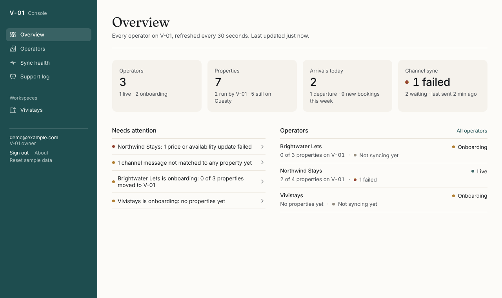
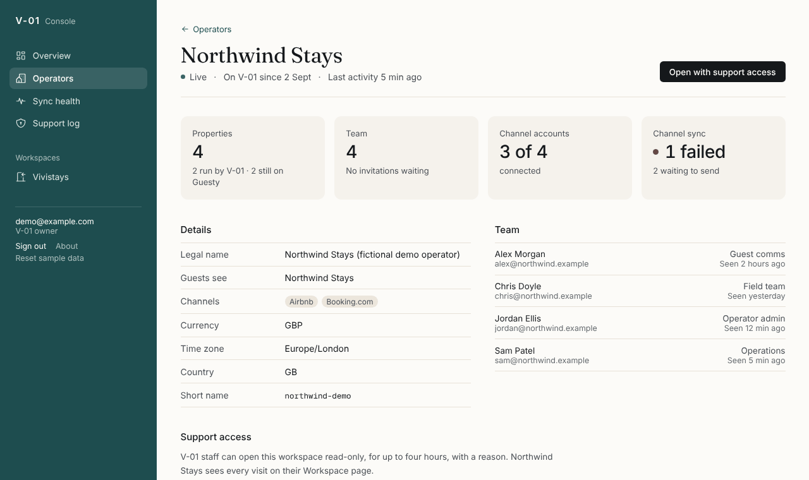
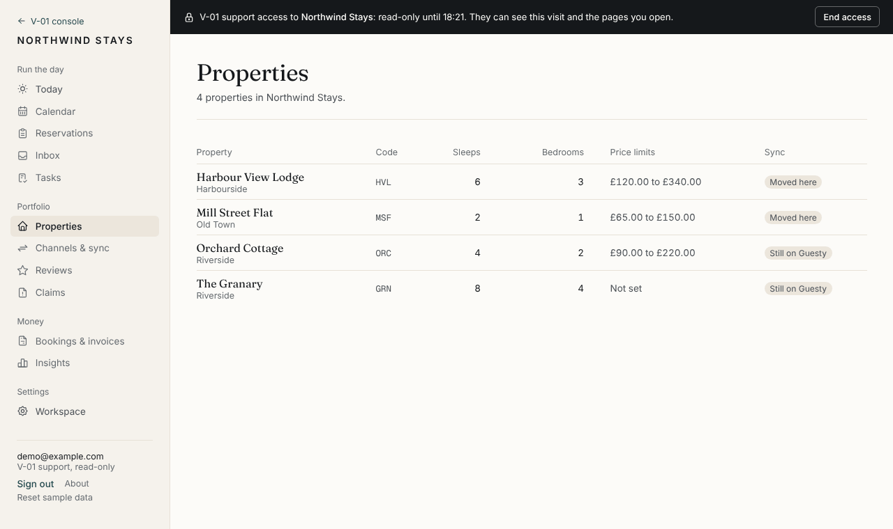
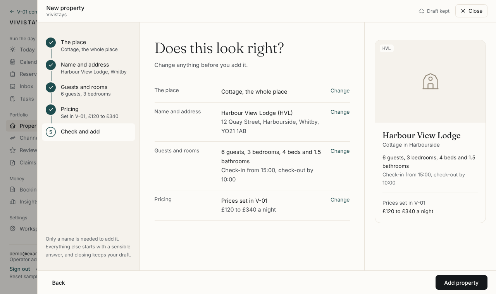
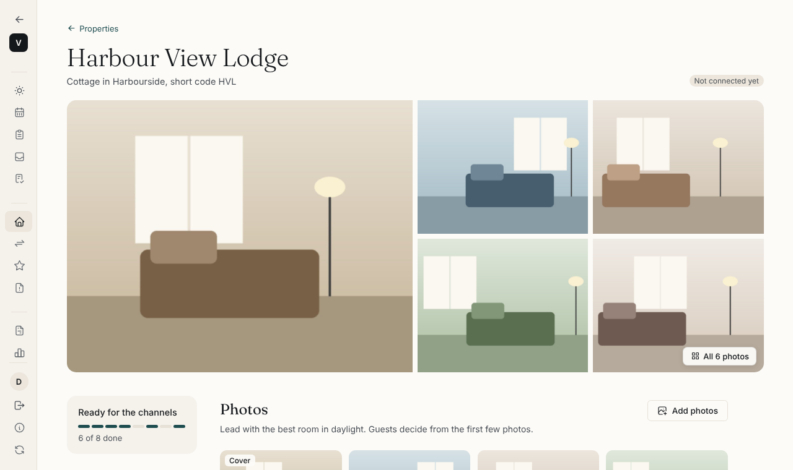
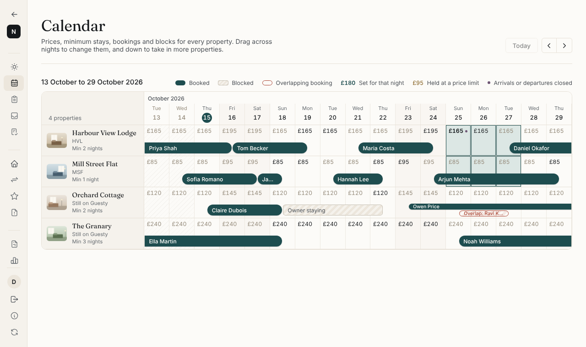

# V-01

Our own platform for running short-stay properties, built to replace Guesty. V-01 is its own company.
Its console oversees every operator on the platform (an operator is a company that manages properties),
and each operator gets its own workspace. Vivistays is the first operator.

## See it running

You need Node 22 and pnpm 10. If you don't have them, install Node 22 from
[nodejs.org](https://nodejs.org), then run `corepack enable`, which sets up pnpm.

```bash
git clone https://github.com/Scofield-Idehen/vivi-001.git
cd vivi-001
pnpm install
pnpm demo
```

Then open http://localhost:5173.

The demo runs on sample data kept in your browser, so it needs no database or sign-in. After pulling new
code, run `pnpm install` again before `pnpm demo`.

## What you'll see

You're signed in as a V-01 owner and a Vivistays admin. Vivistays is empty until its properties come
across from Guesty. Northwind Stays and Brightwater Lets are made-up companies: you belong to Northwind
Stays too, so its sample bookings can be tried in the Calendar, and you open Brightwater Lets with support
access.

- **The V-01 console**
  - Every operator in one place: their properties, their team, and whether prices and bookings are
    flowing to and from the channels.
  - Problems are listed first.
- **Support access**
  - V-01 staff open a company's workspace with a reason and a time limit, and can't change anything.
  - The company sees every visit.
- **A company's workspace**
  - Today, Calendar, Properties and Workspace settings. The sidebar is a row of icons that opens when
    your mouse rests on it.
  - The Calendar: every property by night, with prices, minimum stays, bookings and blocks. Drag across
    nights (and down across properties) to change their price or minimum stay, close them to arrivals
    or departures, or block them. Prices stay within each property's limits.
  - Adding a property: a panel slides in from the right and asks one thing at a time, in Airbnb's three
    stages: about the place; make it stand out (amenities, photos, title and description); then
    pricing. Only a name is required, and closing it keeps the draft.
  - Every property has its own page, where any part of the listing can be changed later: photos, rooms
    and beds, amenities, description, house rules, booking rules, prices and fees, and the licence. A
    checklist shows what the channels still need.
  - The other modules are in the menu and arrive in later phases.


*The console: every operator, what needs attention, and channel sync.*


*One operator: details, team, channels and support history.*


*Support access: the company's workspace, read-only, with a banner showing when access ends.*


*Adding a property: the steps fill with your answers, and the preview shows what you're making.*


*A property's page: the whole listing, every part editable, with what the channels still need.*


*The Calendar: bookings meet on turnover days, and dragging across nights chooses them to change.*

## Coming next

Phase 1 connects V-01 to Airbnb, Booking.com and Vrbo through Channex: prices and availability out,
bookings in. Channex can't send photos, descriptions or amenities to the channels yet, so for now those
are copied across from each property's page. Phase 1 also adds the Reservations and Channels & sync
screens.

---

For developers: [docs/developers.md](docs/developers.md). Decisions and the reasons for them:
[docs/decisions.md](docs/decisions.md).
